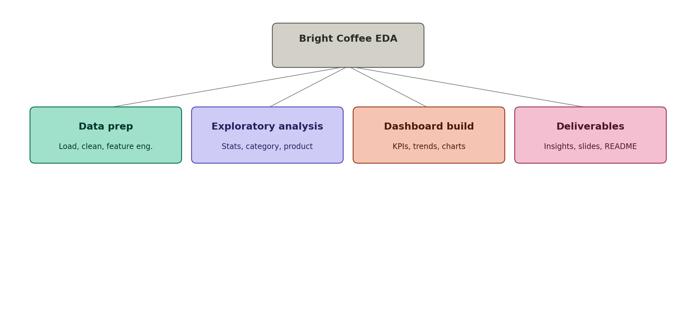
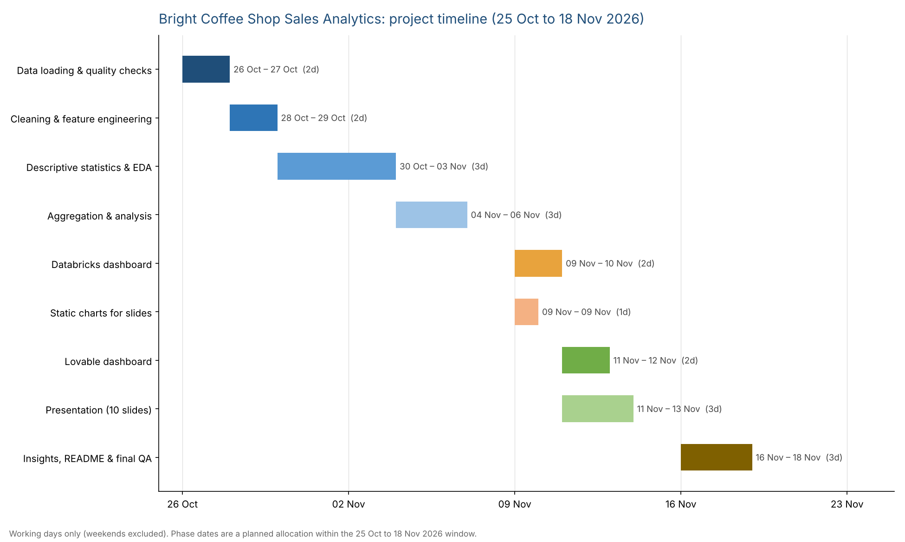

# ☕ Bright Coffee Shop — Sales EDA & Dashboard

A Databricks notebook that cleans, explores, and visualizes the Bright Coffee Shop transaction
data (Jan–Jun 2023, ~149K transactions across 3 NYC store locations), and builds a set of
dashboard-ready charts plus a short auto-generated business summary.

## 📄 Project Description

[Read the project description (PDF)](BrightCoffee_Project_Description.pdf)

## 📑 Contents

- [🔗 Live dashboard](#-live-dashboard)
- [📁 Files](#-files)
- [🧠 Project overview](#-project-overview)
- [📈 Findings](#-findings)
- [🛠️ Tools used](#️-tools-used)
- [🔄 Process](#-process)
- [🗓️ Suggested timeline](#️-suggested-timeline)
- [⚙️ What the notebook does](#️-what-the-notebook-does)
- [🚀 Setup](#-setup)
- [⚠️ Notes / known gotchas](#️-notes--known-gotchas)
- [📌 Building a live dashboard](#-building-a-live-dashboard)

---

## 🔗 Live dashboard

**[View the live dashboard →](https://pixel-perfect-clone-19292.lovable.app)**

<a href="https://pixel-perfect-clone-19292.lovable.app">
  
</a>

An executive dashboard built from this analysis, with pages for **Sales**, **Product**, **Store**,
and **Time** analysis, plus an **Insights & Presentation** view.

| 💰 Total revenue | 🧾 Transactions | 📦 Items sold | 🧮 Avg transaction |
|---|---|---|---|
| $698,812 | 149,116 | 214,470 | $4.69 |

Locations: Astoria · Hell's Kitchen · Lower Manhattan

---

## 📁 Files

| | File | Description |
|---|---|---|
| 📓 | `BrightCoffee_EDA_Dashboard.ipynb` | Databricks notebook — import directly into a Databricks workspace |
| 📄 | `Bright_Coffee_Shop_Sales.csv` | Raw source data |
| 📊 | `Bright_Coffee_Sales_Presentation.pptx` | Slide deck of the analysis findings |
| 🧠 | `mind_map.png` | Mind map of the project structure |
| 🗓️ | `gantt_chart.png` | Illustrative 6-week project timeline |

---

## 🧠 Project overview

**Business question:** Bright Coffee Shop wants to know which products, stores, and times of day drive its revenue, so it can decide where to focus staffing, stock, and promotions.

**Data:** 149,116 transactions from January to June 2023 across three stores (Astoria, Hell's Kitchen, Lower Manhattan).




The project followed four phases, in this order:

- 🗂️ **Data prep** — load, clean, feature engineer
- 🔍 **Exploratory analysis** — descriptive stats, category/product/time breakdowns
- 📊 **Dashboard build** — KPIs, trend charts, pin-to-dashboard
- 📦 **Deliverables** — insights write-up, slide-ready charts, this README

---

## 📈 Findings

Total revenue for the period was $698,812.33 across 214,470 items sold, an average transaction of $4.69.

- **Coffee is the largest category** at $269,952.45. Barista Espresso is the top product at $91,406.20.
- **10:00 is the peak hour**, with $88,673.39 in revenue, so staffing around that hour matters most.
- **Hell's Kitchen earns the most** at $236,511.17, which makes it the benchmark for the other two stores.
- **June 2023 was the strongest month** at $166,485.88.

**Recommendations:** check staffing around 10:00, bundle or promote the weaker categories, find out what Hell's Kitchen does differently and test it elsewhere, and add previous years' data to confirm whether June's lead is seasonal.

---

## 🛠️ Tools used

- **Databricks** (notebook, Unity Catalog Volumes, dashboards)
- **PySpark** for cleaning, feature engineering, and aggregation
- **Spark SQL** (temp view for SQL-based dashboard queries)
- **pandas** and **Matplotlib** for the slide-ready charts
- **Lovable** for the interactive dashboard
- **Microsoft PowerPoint** for the presentation
- **GitHub** for version control and documentation

---

## 🔄 Process

1. **Load and check the data:** read the semicolon-delimited CSV, fix the comma decimal separator in `unit_price`, and check for nulls and duplicate transactions.
2. **Clean and engineer features:** cast types, parse dates and times, and add revenue, month, weekday, and hour fields.
3. **Explore:** run descriptive statistics, then break revenue down by month, category, product, hour, weekday, and store.
4. **Build the dashboard:** pin each chart to a Databricks dashboard and build the Lovable dashboard from the same results.
5. **Communicate:** write the key insights and recommendations in the notebook, then summarise them in the slide deck.

---

## 🧠 Project overview

## 🗓️ Suggested timeline



This is an illustrative plan, not tied to real dates — adjust the weeks to your actual schedule.

---

## ⚙️ What the notebook does

1. **Load** — reads the `;`-delimited CSV (comma-decimal `unit_price`, e.g. `3,1`) into a Spark DataFrame
2. **Data quality checks** — null counts per column, duplicate `transaction_id` / duplicate row checks
3. **Cleaning & feature engineering** — casts types, parses date/time, adds:
   - `revenue` = `transaction_qty × unit_price` (not present in the raw data)
   - `month`, `day_of_week`, `hour_of_day`, `is_weekend`
4. **Descriptive statistics** — summary stats on quantity, price, revenue
5. **Dashboard section** — one `display()` chart per cell, each pinnable to a Databricks Dashboard:
   - Headline KPIs (total revenue, transactions, units sold, avg order value)
   - Daily and monthly revenue trend
   - Revenue by product category
   - Top 10 products by revenue
   - Revenue by hour of day (peak hours)
   - Revenue by day of week
   - Revenue by store location
   - Order value distribution (histogram)
6. **Static charts for a slide deck** — Matplotlib PNGs (monthly trend, category breakdown, peak hours) saved to `/tmp/` on the cluster driver
7. **Auto-generated insights** — a short written summary (top category, top product, peak hour, best store, best month) with a few recommendations
8. **Dashboard how-to** — steps for pinning the notebook's charts into a live Databricks Dashboard

---

## 🚀 Setup

### 1️⃣ Upload the data

Databricks now requires data to live in a **Unity Catalog Volume** (the legacy DBFS root /
`/FileStore` path is disabled on most workspaces).

1. In the left sidebar, go to **Catalog**.
2. Pick or create a catalog → schema → **Volume**.
3. Open the Volume and use **Upload to this volume** to add `Bright_Coffee_Shop_Sales.csv`.
4. Note the full path, which will look like:
   ```
   /Volumes/<catalog>/<schema>/<volume>/Bright_Coffee_Shop_Sales.csv
   ```

### 2️⃣ Import the notebook

In Databricks: **Workspace → Import → File**, and select `BrightCoffee_EDA_Dashboard.ipynb`.

### 3️⃣ Point the notebook at your data

At the top of the notebook there's a **`data_path`** widget. Click into it and paste the Volume
path from step 1, then run the notebook top to bottom.

---

## ⚠️ Notes / known gotchas

- 🖥️ **Serverless compute** — the notebook does not call `.cache()`/`.persist()`, since explicit
  caching isn't supported on serverless compute clusters. If you're running on a classic
  (non-serverless) cluster, you can add `.cache()` back after the cleaning step for a speed-up.
- 🧩 **Widget values persist across runs** — if you change the default `data_path` in the code but
  the widget already has an old value from a previous run, Databricks keeps the old value. Either
  edit the widget box directly in the notebook UI, or clear it with
  `dbutils.widgets.removeAll()` and re-run.
- 🖼️ **Exporting charts for slides** — the Matplotlib PNGs are saved to `/tmp/` on the cluster driver,
  which isn't directly downloadable from the UI. Copy them to a Volume first, e.g.:
  ```python
  dbutils.fs.cp("file:/tmp/monthly_revenue_trend.png", "/Volumes/<catalog>/<schema>/<volume>/charts/")
  ```
  then download from the Catalog file browser.

---

## 📌 Building a live dashboard

Every chart cell in Section 6 renders via `display()`. Hover over a chart's output and click
**"+ Add to dashboard"** (or the "..." menu) to pin it — repeat for each chart, choosing the same
dashboard each time. Once all tiles are pinned, open the dashboard from the notebook's sidebar,
arrange the layout, and **Publish** (or **Schedule**) to share a live, refreshable dashboard.
